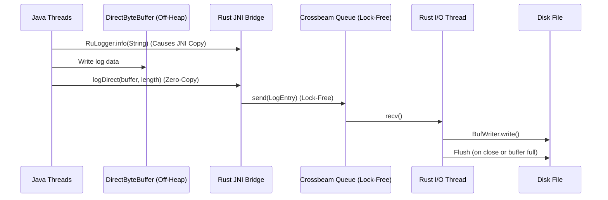

# RuLogger Design Architecture

## Overview
RuLogger bridges Java and Rust via JNI to achieve extremely fast, memory-efficient logging. It aims to eliminate JVM Garbage Collection pauses related to log strings and avoids blocking JVM threads on file I/O operations.

## Core Concepts

1. **Lock-Free Queueing**: Log messages are passed into a Rust `crossbeam-channel`, which provides lock-free queueing, allowing multiple Java threads to submit logs concurrently without mutually blocking each other.
2. **Asynchronous File I/O**: A dedicated native OS thread running in Rust pulls from the queue and writes sequentially to disk using `BufWriter`.
3. **Zero-Copy DirectBuffers**: To avoid JNI string copies entirely, Java can allocate memory outside the JVM heap using `DirectByteBuffer`. Rust can safely read this memory via a pointer, eliminating GC and memory duplication.

## Architecture Flow (Mermaid Diagram)

## Advantages
- **JVM Heap Stability**: DirectBuffer logging puts zero pressure on the JVM heap.
- **Throughput**: Java threads are never blocked by slow disk operations.
- **Latency**: The lock-free queue minimizes contention among highly concurrent Java applications.
